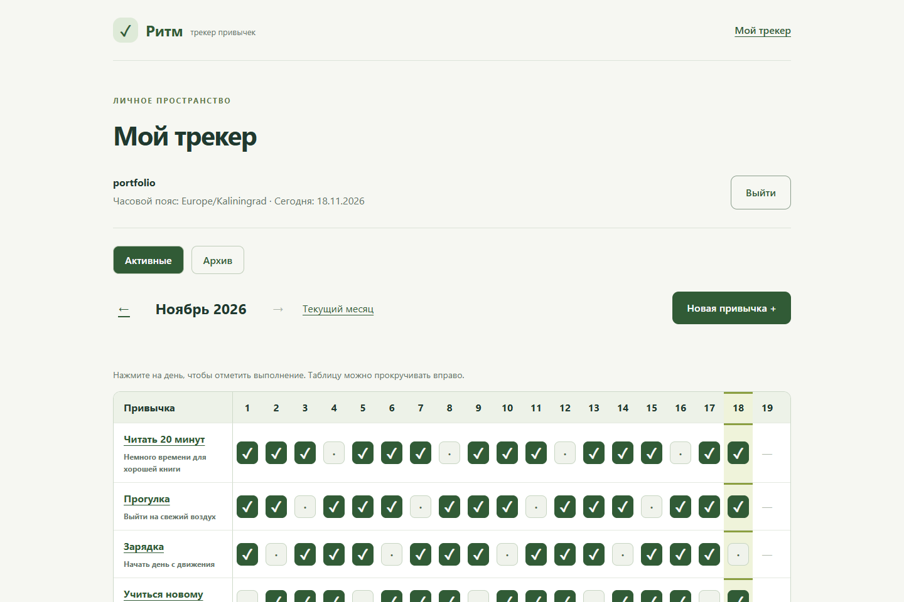
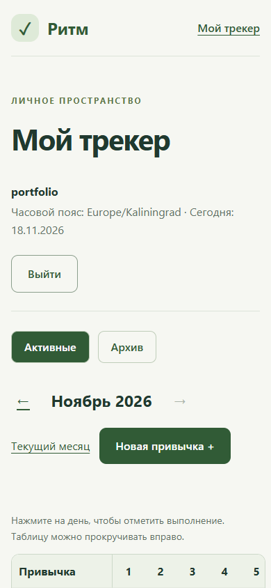

<!-- portfolio-case:v1 -->
# Ритм — трекер привычек

Личный календарь привычек с отметками без перезагрузки, статистикой выполнения, сериями и архивом.

[Все проекты](https://github.com/gek-finn)

## Задача

Дать человеку простой способ ежедневно отмечать привычки и видеть регулярность занятий.

## Что реализовано

- Регистрация и отдельные данные каждого пользователя.
- Календарь привычек и отметки выполнения.
- Процент выполнения, текущая и лучшая серии.
- Архив с сохранением истории.
- Часовые пояса и интерфейс для телефона.

## Технологии

Python · Flask · SQLite · Flask-Login · Flask-WTF · JavaScript

## Статус и ограничения

Учебный веб-проект по мотивам открытого заказа. Это веб-приложение, а не Telegram Mini App. Восстановления пароля и уведомлений нет.

## Приложение

[https://habits.gilinsky.ru](https://habits.gilinsky.ru) — Для личного календаря требуется регистрация. Доступность сайта в рамках этой подготовки не проверялась.

## Интерфейс

Мобильный экран и другие разделы

## Запуск

[Инструкция установки и запуска](docs/SETUP.md).

## О кейсе

Описание показывает реализованные функции. Подтверждённые показатели продаж, экономии времени и коммерческого внедрения в этом кейсе не заявляются.
